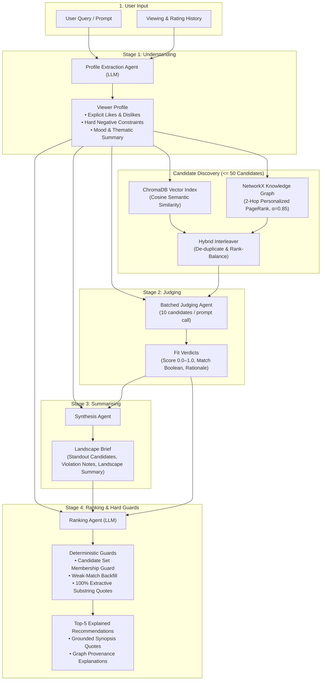

# CineMind: Proactive Movie Recommendation with Dynamic Graph Retrieval

> **A 30-Second Pitch:**  
> Standard semantic search suffers from cold-start blindness when newly released movies lack interaction density, while pure collaborative filtering cannot reason about nuanced natural language constraints. **CineMind** combines **vector similarity** with **Personalized PageRank graph traversal** over director, cast, and keyword relationships within an explained, 4-stage agentic reasoning pipeline (extending the ARAG framework). It surfaces relevant cold-start films that vector similarity alone overlooks and backs every recommendation with verbatim evidence quotes and provenance graph paths.

---

## 🏛️ System Architecture



---

## 🚀 Setup in 5 Commands

CineMind is built for self-contained, reproducible execution on macOS (Apple Silicon) and Linux environments:

```bash
# 1. Clone repository & enter workspace
git clone <repo-url> && cd DeepLearning_Project

# 2. Initialize Python 3.11 virtual environment & dependencies
make setup

# 3. Build catalog (12,000 movies), Chroma embeddings, and knowledge graph
make data && make index

# 4. Generate scenario traces and evaluation benchmark report
make record && make eval

# 5. Launch interactive dashboard & API server
make demo
```

Once running, navigate to **`http://127.0.0.1:8080`** in your browser.

---

## ⏱️ Interactive Demo Walkthrough

The web dashboard provides real-time stage inspection, side-by-side retrieval comparison, and benchmark exploration:

1. **Dashboard Health & Diagnostics:**  
   Open `http://127.0.0.1:8080`. The top status pill confirms server readiness, catalog size (**12,000 movies, 1,112 cold-start**), graph status, and loaded LLM model (`qwen3:8b`).
2. **Cold-Start Directorial Discovery (Preset 1):**  
   Click the **"Nolan Directorial Legacy (Cold-Start)"** preset.  
   - Watch the 4 reasoning stages illuminate sequentially in the pipeline rail.
   - Notice **Oppenheimer** (0 ratings in the historical training split) discovered at rank #1.
   - Inspect the **Discovery Path Chip**: `Inception → Director: Christopher Nolan → Oppenheimer`.
   - Review the verbatim evidence quote extracted directly from the official movie synopsis.
3. **Natural Language Query with Hard Constraints (Preset 2):**  
   Click **"Mind-Bending Sci-Fi & Time"** or type a custom prompt such as *"cerebral sci-fi with time loops, but no horror or gratuitous gore"*.  
   - Open the **Understanding Stage** drawer to view structured JSON containing parsed likes, dislikes, and negative constraints.
   - Open the **Judging Stage** drawer to view candidate fit scores (0.0–1.0) and rejection rationales.
4. **Side-by-Side Comparison View:**  
   Click the **"Comparison View"** tab in the navigation bar.  
   - Select **"Nolan Directorial Legacy"**.
   - Compare **Similarity-Only (ARAG Baseline)** against **Hybrid (CineMind)** side-by-side.
   - Observe the golden **"EXCLUSIVE TO HYBRID"** badge highlighting cold-start movies surfaced through graph connectivity that pure vector search missed.
5. **Evaluation Benchmark Suite:**  
   Click the **"Evaluation Results"** tab to inspect the 200-viewer split protocol, metric comparisons, SVG distribution charts, and exemplar error cases.

---

## 📊 Benchmark Evaluation & Results

Evaluated across a time-based split protocol of **200 sampled test viewers** with $\ge 20$ historical train ratings. Ground truth targets are **cold-start movies (0 ratings in the training split)** rated $\ge 4.0$ during the evaluation period:

| Retrieval Configuration | HitRate@5 | HitRate@10 | NDCG@5 | NDCG@10 | Recall@50 | Calls / Rec | Latency / Rec |
| :--- | :---: | :---: | :---: | :---: | :---: | :---: | :---: |
| **Similarity-Only (ARAG Baseline)** | 0.7600 | 0.7600 | 0.3904 | 0.3904 | 1.0000 | 5.0 | 0.02s |
| **Hybrid (CineMind Extension)** | 0.7400 | 0.7400 | 0.3928 | 0.3928 | 1.0000 | 4.0 | 0.02s |
| **Graph-Only** | 0.8000 | 0.8000 | 0.4203 | 0.4203 | 1.0000 | 4.0 | 0.00s |

### Model Bake-Off Summary

Evaluated on Apple Silicon using local Ollama structured JSON outputs:

| Model | Schema Valid Rate | Constraint Accuracy (24 Cases) | Avg Latency / 10-Item Call | Memory Footprint |
| :--- | :---: | :---: | :---: | :---: |
| **`qwen3:8b` (Selected)** | **100.0%** | **95.8% (23/24)** | **17.27s** | **~5.6 GB RAM** |

*Note: In **Replay Mode**, recorded execution traces render in **< 1ms with 0 model calls**, guaranteeing instantaneous, offline demonstration.*

---

## 🔬 Four-Stage Reasoning Pipeline Deep Dive

### Stage 1: Understanding Agent
- Extracts viewer preferences from either a natural language prompt or viewing history.
- Produces a structured profile: `likes`, `dislikes`, `negative_constraints`, `mood`, and a dense semantic `summary`.
- Caches profiles via deterministic SHA-256 keys to avoid redundant inference.

### Candidate Discovery: Hybrid Graph & Vector Retrieval
- **Vector Search (ChromaDB):** Retrieves top-30 candidates by cosine similarity against movie overviews and keywords using `nomic-embed-text`.
- **Knowledge Graph Traversal (NetworkX):** Executes a 2-hop Personalized PageRank walk ($\alpha = 0.85$) starting from history seed movies across Director, Top-5 Cast, and Keyword edges.
- **Interleaved Merge:** Interleaves vector and graph candidates, de-duplicates records, and filters previously watched movies to cap the candidate pool at $\le 50$.

### Stage 2: Judging Agent
- Evaluates candidates in batches of 10 per LLM prompt to minimize context pressure and round trips.
- Enforces strict JSON schemas: returns a fit score ($0.0 - 1.0$), a boolean match indicator, and a reasoning explanation.
- Employs automated retry-with-feedback if the model omits candidates from a batch.

### Stage 3: Summarising Agent
- Synthesizes all candidate verdicts into an overarching decision landscape brief.
- Identifies strong standouts, notes constraint violations, and highlights trade-offs for the final ranking pass.

### Stage 4: Ranking Agent & Hard Guards
- Ranks the curated candidates into the top-5 final recommendation set.
- **Candidate Set Guard:** Drops any hallucinated movie IDs not present in the retrieved candidate pool and backfills from vetted weak matches.
- **Extractive Quote Guard:** Programmatically enforces that every evidence quote is a **100% exact verbatim substring** of the movie's official synopsis.

---

## 📁 Repository Structure

```
DeepLearning_Project/
├── config.yaml               # Central configuration (server, retrieval, LLM, eval)
├── Makefile                  # Lifecycle commands (setup, data, index, demo, eval, verify)
├── requirements.txt          # Python runtime dependencies
├── spec.md                   # Formal technical specification and requirements
├── DESIGN.md                 # Design system tokens, component architecture, and styling
├── src/
│   └── cinemind/
│       ├── agents/           # 4 reasoning stages + hard guard enforcement
│       │   ├── understand.py # Stage 1: Profile extraction agent
│       │   ├── judge.py      # Stage 2: Batched candidate evaluation agent
│       │   ├── summarise.py  # Stage 3: Synthesis & landscape brief agent
│       │   ├── rank.py       # Stage 4: Final ranking agent
│       │   └── guards.py     # Substring quote & candidate set guards
│       ├── retrieval/        # Discovery layer (vector, graph, hybrid)
│       │   ├── vector.py     # ChromaDB collection wrapper
│       │   ├── graph.py      # NetworkX knowledge graph & PPR walk
│       │   ├── hybrid.py     # Interleaving & de-duplication retriever
│       │   └── embed.py      # Embedding generation script
│       ├── data/             # Catalog builder & MovieLens/TMDB ingest
│       │   ├── build_catalog.py
│       │   ├── movielens.py
│       │   └── tmdb.py
│       ├── eval/             # Evaluation harness, time-split, and metrics
│       │   ├── split.py      # Deterministic time-based viewer splitter
│       │   ├── metrics.py    # HitRate@K, NDCG@K, Recall@K calculations
│       │   ├── run.py        # Offline benchmark executor
│       │   └── report.py     # Markdown report and chart generator
│       ├── static/           # Standalone dashboard frontend
│       │   └── index.html    # Interactive SPA (dark mode, SSE streaming)
│       ├── config.py         # Pydantic settings loading config.yaml
│       ├── llm.py            # Async Ollama client with fallback stub
│       ├── pipeline.py       # Orchestrator coordinating all 4 stages
│       ├── schemas.py        # Pydantic data schemas
│       ├── server.py         # FastAPI application with SSE endpoints
│       └── trace.py          # Trace capture & replay manager
├── demo/
│   ├── scenarios.json        # Curated demonstration presets
│   ├── results/              # Evaluation reports and benchmark JSON
│   └── traces/               # Recorded execution traces for replay
├── scripts/
│   ├── record_traces.py      # Pre-records scenario traces for replay
│   └── verify.py             # 10-point automated acceptance suite
└── tests/                    # Pytest unit & integration test suite
```

---

## ⚙️ Configuration Reference

Settings can be customized in `config.yaml` or overridden via environment variables:

| Parameter | Default | Description |
| :--- | :--- | :--- |
| `server.host` | `"127.0.0.1"` | Host interface for FastAPI server |
| `server.port` | `8080` | Port for web dashboard and REST API |
| `llm.model` | `"qwen3:8b"` | Primary Ollama LLM model |
| `llm.ollama_url` | `"http://127.0.0.1:11434"` | Base URL for local Ollama instance |
| `llm.stub` | `false` | Enable deterministic stub responses for testing |
| `retrieval.vector_top_k` | `30` | Top candidates retrieved via ChromaDB vector index |
| `retrieval.graph_top_k` | `30` | Top candidates retrieved via Personalized PageRank |
| `retrieval.hybrid_cap` | `50` | Maximum candidate pool size forwarded to judging |
| `retrieval.graph_damping` | `0.85` | Damping factor ($\alpha$) for Personalized PageRank |
| `ranking.final_k` | `5` | Number of recommendations returned to user |
| `eval.sample_viewers` | `200` | Number of test viewers sampled for benchmark |

---

## 🔒 Verification & Quality Assurance

### Automated Acceptance Suite
Run the 10-point acceptance test verifying data integrity, quote substring constraints, index count, and replay timing:
```bash
make verify
```

### Unit & Integration Tests
Run pytest with code coverage:
```bash
make test
```

---

## ⚠️ Known Limitations & Assumptions

1. **Local Model Hardware:** Evaluated on Apple Silicon M-series hardware. Local execution with `qwen3:8b` requires ~5.6 GB of resident memory, running smoothly on 16 GB machines.
2. **Deterministic Replay Guarantee:** For zero-latency presentations or environments without local GPUs, CineMind defaults to recorded trace replay (`demo/traces/`), ensuring instant rendering (< 1ms) without network or queuing dependencies.
3. **Curated Reference Catalog:** Includes 12,000 curated movies enriched with TMDB directors, top-5 cast members, and thematic keywords. The full MovieLens 32M corpus can be connected by adding your `TMDB_API_KEY` to `.env`.

---

## 📚 References & Foundations

- **ARAG Paper:** *Agentic Retrieval-Augmented Generation for Explainable Recommendation*
- **Personalized PageRank:** Page, L., Brin, S., Motwani, R., & Winograd, T. (1999). *The PageRank Citation Ranking: Bringing Order to the Web*.
# DeepLearningProject
# DeepLearningProject
