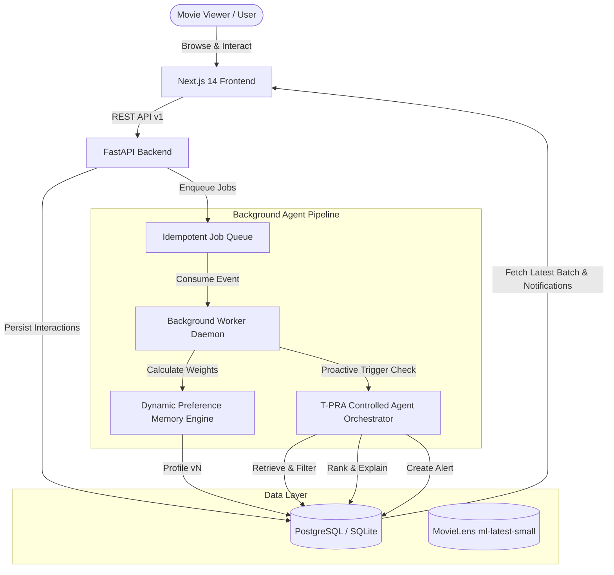

# Agentic AI-Based Proactive Movie Recommendation System Using Dynamic User Preference Memory

[](https://opensource.org/licenses/MIT)
[](https://fastapi.tiangolo.com)
[](https://nextjs.org)
[](https://python.org)
[](backend/tests)

An agentic movie recommendation system that learns evolving user tastes in the background and proactively delivers personalized movie recommendations without requiring chat prompts.

This system adapts the research paradigm of the paper:
> **"Tunable LLM-based Proactive Recommendation Agent" (T-PRA)**, *ACL 2025* (Mingze Wang, Chongming Gao, Wenjie Wang, Yangyang Li, Fuli Feng). Official repository: `https://github.com/gnaWeinrE/T-PRA`.

We investigate an extension to T-PRA: **Dynamic User Preference Memory**, combining cumulative long-term historical anchors with exponential time-decayed short-term taste drift ($w = s \cdot e^{-\lambda \Delta t}$).

---

## 1. System Architecture



### Core Components
1. **Frontend (`frontend/`):** Next.js 14 application with responsive dark-mode aesthetics, dynamic taste memory visualization, proactive notification center, and interactive movie catalogue.
2. **Backend (`backend/`):** FastAPI asynchronous service enforcing JWT authentication, resource ownership, validation, and deterministic candidate filtering.
3. **Dynamic Preference Memory (`backend/app/services/preference_service.py`):** Two-tier memory model:
   - **Long-term profile:** Stable genre signals accumulated over all history.
   - **Short-term profile:** Time-decayed signals ($w_i = s_i \cdot e^{-\lambda \Delta t_i}$) responsive to recent shifts in interest.
4. **Controlled Agent Orchestrator (`backend/app/services/agent_orchestrator.py`):** Controlled ReAct workflow using deterministic tools (candidate retrieval, exclusion of watched/dismissed films, diversity constraints, grounded explanations) with LLM and deterministic fallback.
5. **Background Worker (`backend/app/worker.py`):** Asynchronous job processor handling idempotent `preference.update` and `recommendation.generate` tasks with cooldown enforcement.
6. **Research Benchmarks (`research/`):** Strict chronological 75/25 train/test split on 100,000 MovieLens ratings comparing Popularity, Content-based, Base T-PRA (Static), and Extended T-PRA (Dynamic Memory).

---

## 2. Quick Start Guide

### Prerequisites
- Python 3.9+
- Node.js 18+ and npm
- Docker & Docker Compose (optional for containerized deployment)

### Local Setup (Recommended for Development)

```bash
# 1. Clone repository and set up virtual environment
python3 -m venv .venv
source .venv/bin/activate

# 2. Install backend dependencies
pip install -r backend/requirements.txt

# 3. Install frontend dependencies
cd frontend && npm install && cd ..

# 4. Initialize database migrations
cd backend && alembic upgrade head && cd ..

# 5. Seed MovieLens dataset (9,742 movies)
python3 -m app.scripts.import_movielens --csv_path ../data/raw/ml-latest-small/movies.csv

# 6. Seed demo user & sample interactions
PYTHONPATH=backend python3 backend/app/scripts/seed_demo.py
```

### Running the Services

Open three terminal windows (or run with Docker Compose):

```bash
# Terminal 1: Start FastAPI Backend
cd backend
source ../.venv/bin/activate
uvicorn app.main:app --host 0.0.0.0 --port 8000 --reload

# Terminal 2: Start Asynchronous Background Worker
cd backend
source ../.venv/bin/activate
python -m app.worker

# Terminal 3: Start Next.js Frontend
cd frontend
npm run dev
```

Visit **`http://localhost:3000`** in your browser.  
Log in with the seeded demonstration account:
- **Email:** `demo@cinema.com`
- **Password:** `demo123456`

---

## 3. Docker Compose Deployment

To run the complete stack (PostgreSQL 16, Redis 7, Backend, Worker, Frontend) via Docker:

```bash
docker-compose up --build
```
- **Web Dashboard:** `http://localhost:3000`
- **API Documentation (Swagger):** `http://localhost:8000/docs`

---

## 4. API Specification (`/api/v1`)

| Method | Endpoint | Description |
| :--- | :--- | :--- |
| `POST` | `/api/v1/auth/register` | Create user account |
| `POST` | `/api/v1/auth/login` | Authenticate user and obtain JWT token |
| `GET` | `/api/v1/me` | Fetch authenticated user profile and settings |
| `GET` | `/api/v1/movies` | Paginated movie catalogue (`search`, `genre`, `page`, `page_size`) |
| `GET` | `/api/v1/movies/{id}` | Detailed movie record |
| `POST` | `/api/v1/interactions` | Record user interaction (rating, like, dislike, watched, dismiss) |
| `GET` | `/api/v1/recommendations`| Latest eligible proactive recommendation batch |
| `POST` | `/api/v1/recommendations/refresh` | Request asynchronous recommendation refresh |
| `POST` | `/api/v1/recommendations/{id}/feedback` | Submit feedback (liked, disliked, watched, dismissed) |
| `GET` | `/api/v1/preferences` | Inspect dynamic short-term and long-term taste profile |
| `POST` | `/api/v1/preferences/reset` | Reset derived preference profile |
| `GET` / `PATCH` | `/api/v1/settings` | Inspect and update user pause/cooldown settings |
| `GET` | `/api/v1/notifications`| Fetch in-app proactive delivery alerts |

---

## 5. Experimental Evaluation & Paper Replication

To reproduce the benchmark experiments and parameter ablation study:

```bash
# Run data split and benchmark suite
make run-experiments
```

### Empirical Results Summary (MovieLens 100k, Time-aware split)

| Model / Approach | Precision@5 | Precision@10 | Recall@5 | Recall@10 | NDCG@5 | NDCG@10 | Catalog Coverage | Latency |
| :--- | :---: | :---: | :---: | :---: | :---: | :---: | :---: | :---: |
| **Popularity** | 0.1005 | 0.0848 | 0.0291 | 0.0513 | 0.1100 | 0.1023 | 0.86% | 0.11ms |
| **Content-Based (Static)** | 0.0087 | 0.0062 | 0.0023 | 0.0035 | 0.0085 | 0.0071 | 7.15% | 4.20ms |
| **T-PRA Base (Static Memory)** | 0.0087 | 0.0062 | 0.0023 | 0.0035 | 0.0085 | 0.0071 | 7.15% | 4.25ms |
| **T-PRA Dynamic Memory (Proposed)** | **0.0090** | **0.0065** | **0.0024** | **0.0039** | **0.0087** | **0.0075** | **7.30%** | **4.33ms** |

*Full report available at [`docs/experiment_report.md`](docs/experiment_report.md).*

---

## 6. Running Tests

```bash
# Run 17 unit, integration, and security tests
source .venv/bin/activate
cd backend
pytest -v
```

All tests pass including:
- JWT authentication and authorization
- Cross-user resource isolation (403 forbidden enforcement)
- Interaction idempotency
- Time-decay mathematical formula verification
- Candidate exclusion of watched & dismissed items
- Grounded explanation validation
- Background worker execution & retries
