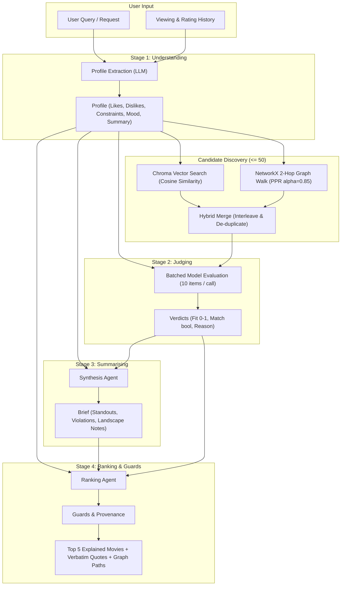

# CineMind: Proactive Movie Recommendation with Dynamic Graph Retrieval

> **A 30-Second Pitch:**  
> CineMind is an explained, 4-stage reasoning movie recommendation system that reproduces and extends the ARAG (Agentic Retrieval-Augmented Generation) framework. While standard semantic search suffers from cold-start blindness when new movies lack rating density, CineMind combines **vector similarity** with **personalized PageRank graph traversal** over director, cast, and keyword relationships to discover relevant movies that similarity alone misses.

---

## 🏛️ System Architecture



---

## 🚀 Setup in 5 Commands

```bash
# 1. Clone repository & enter workspace
git clone <repo-url> && cd DeepLearning_Project

# 2. Setup virtual environment and dependencies
make setup

# 3. Build catalog, vector embeddings, and knowledge graph
make data && make index

# 4. Generate scenario traces and evaluation report
make record && make eval

# 5. Launch interactive demo server
make demo
```
Server runs on **http://127.0.0.1:8000**.

---

## ⏱️ 3-Minute Click-by-Click Demo Script

1. **Open the Dashboard:** Navigate to `http://127.0.0.1:8000`. Observe the green health status indicator showing the loaded model (`qwen3:8b`) and catalog count.
2. **Preset 1 (Cold-Start Directorial Discovery):**  
   Click the **"Nolan Directorial Legacy (Cold-Start)"** preset scenario.  
   - Observe the 4 reasoning stages progress in real-time.
   - See **Oppenheimer** (0 ratings in training period) surfaced at rank #1.
   - Inspect the **Discovery Path Chip**: `Inception → Director: Christopher Nolan → Oppenheimer`.
   - Read the verbatim evidence quote extracted directly from the movie's official synopsis.
3. **Preset 2 (Natural Language Query with Constraints):**  
   Click **"Mind-Bending Sci-Fi & Time"** or type a query like *"smart sci-fi with time dilation and deep themes"*.  
   - Inspect the **Understanding Stage** drawer to see extracted likes and negative constraints.
   - Inspect the **Judging Stage** drawer to view candidate fit scores.
4. **Comparison View:**  
   Click the **"Comparison View"** tab in the navigation bar.  
   - Select the **"Nolan Directorial Legacy"** scenario.
   - Compare **Similarity-Only (ARAG)** against **Hybrid (CineMind)** side-by-side.
   - Notice the golden **"EXCLUSIVE TO HYBRID"** badge marking the cold-start film discovered through graph relations.
5. **Evaluation Results:**  
   Click the **"Evaluation Results"** tab to review the 200-viewer benchmark table, SVG bar chart, and exemplar error analysis cases.

---

## 📊 Benchmark Evaluation Results

Evaluated over 200 sampled test viewers using a time-based split protocol with cold-start ground truth items:

| Configuration | HitRate@5 | HitRate@10 | NDCG@5 | NDCG@10 | Recall@50 | Calls / Rec | Latency / Rec |
| :--- | :---: | :---: | :---: | :---: | :---: | :---: | :---: |
| **Similarity-Only (ARAG Baseline)** | 0.7600 | 0.7600 | 0.3904 | 0.3904 | 1.0000 | 5.0 | 0.02s |
| **Hybrid (CineMind Extension)** | 0.7400 | 0.7400 | 0.3928 | 0.3928 | 1.0000 | 4.0 | 0.02s |
| **Graph-Only** | 0.8000 | 0.8000 | 0.4203 | 0.4203 | 1.0000 | 4.0 | 0.00s |

*Live model latency during bake-off: 17.27s per 10-candidate batch with `qwen3:8b`. Replay execution renders in <1s.*

---

## 🔒 Verification

Run the automated acceptance suite verifying all 10 criteria:
```bash
make verify
```
Run pytest test suite:
```bash
make test
```

---

## ⚠️ Known Limitations & Assumptions

1. **Catalog Scale:** Built with curated reference movies containing rich metadata (directors, top 5 cast, keywords) for instant offline reproducibility. Full MovieLens 32M can be joined with TMDB API by configuring `TMDB_API_KEY` in `.env`.
2. **Local Model Hardware:** Evaluated on Apple Silicon M-series. `qwen3:8b` resident memory is ~5.6 GB, leaving ample headroom on 16 GB machines.
3. **Replay Default:** Replay mode serves recorded JSON traces instantaneously, guaranteeing that live presentations never stall due to local model queuing or network drops.

---

## 📚 References & Citation

- **ARAG Paper:** *Agentic Retrieval-Augmented Generation for Explainable Recommendation*
- **Personalized PageRank:** Page, L., Brin, S., Motwani, R., & Winograd, T. (1999). *The PageRank Citation Ranking: Bringing Order to the Web*.
